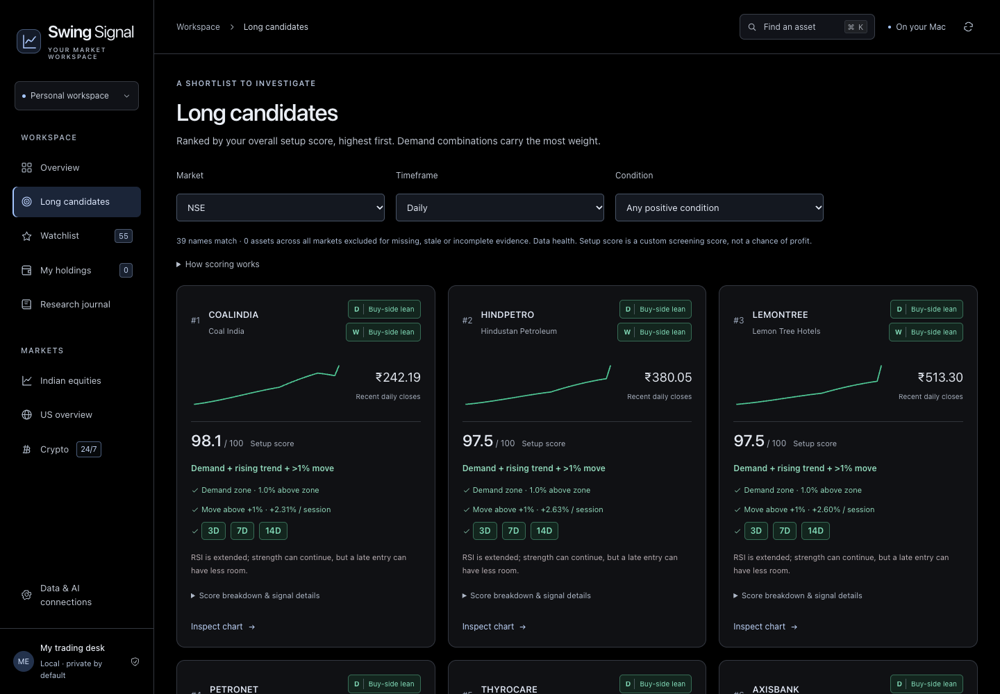

# Swing Signal

### Turn technical noise into a swing-trade shortlist.

[](https://github.com/joshuadominic0598/stock-tracker-swing-trades/actions/workflows/ci.yml)
[](LICENSE)

**See the market’s direction. Read bull/bear pressure. Find stocks where your green flags line up.**

Swing Signal is a local research app for swing traders who hold positions for weeks or months and want to notice the short bursts that can move a trade forward. It translates RSI, Stoch RSI, volume, moving averages and price structure into clear flags, daily/weekly readings, and a ranked list of long candidates.

Instead of checking every chart from scratch, start with the names showing more of your preferred upside conditions—then inspect the chart, the demand zone and the risks before deciding.



_Illustrative interface using deterministic sample candles. These are not live prices or recommendations._

## What can you use it for?

| Your question                                     | How Swing Signal helps                                                                                      |
| ------------------------------------------------- | ----------------------------------------------------------------------------------------------------------- |
| **Are bulls or bears gaining the upper hand?**    | Compare market direction, sector buy/sell-side counts and each stock’s daily/weekly technical lean.         |
| **Which stock deserves my attention today?**      | Open **Long candidates**: scored out of 100, ranked highest first, with the conditions behind every match.  |
| **Is a dip becoming a potential swing setup?**    | Check demand proximity, RSI recovery, Stoch RSI pullbacks and support retest/rebound patterns.              |
| **Is the move starting to pick up?**              | Read separate **3D / 7D / 14D** green/red flags, volume participation and moves above +1%.                  |
| **Where could the setup fail?**                   | Inspect supply zones, broken support, contrary signals and your own invalidation level.                     |
| **Does the stock have a story behind the chart?** | Read matched news, sampled public discussion, company financials and stock-specific AI with sector context. |
| **How do I keep my plan consistent?**             | Save your thesis, invalidation, holding horizon, review date and actual position details locally.           |

**More green flags mean more of your screening conditions are present.** Demand plus a positive period trend or a move above 1% strengthens the long-candidate ranking. Red flags and nearby supply remain visible, so a promising setup never hides its counterpoints.

Bull/bear readings describe the app’s technical rule balance—not measured order flow. Green pullback flags can appear while price is still falling. Scores help prioritize research; they are not a probability that price will rise.

## Start in a few minutes

**Requirements:** Python 3.9+ and a modern browser. macOS and Linux use the Python standard library; Windows also needs the timezone package in `requirements.txt`. Node.js is only for development checks.

### macOS / Linux

```sh
git clone https://github.com/joshuadominic0598/stock-tracker-swing-trades.git
cd stock-tracker-swing-trades
python3 launch.py
```

On macOS, you can also double-click **Start Swing Signal.command** in Finder. Keep its Terminal window open while using the app. Press **Control-C** to stop; your saved work stays on disk.

### Windows

```powershell
git clone https://github.com/joshuadominic0598/stock-tracker-swing-trades.git
cd stock-tracker-swing-trades
py -3 -m venv .venv
.venv\Scripts\python -m pip install -r requirements.txt
.venv\Scripts\python launch.py
```

The launcher opens your browser and reuses the existing Swing Signal server, or chooses an available localhost port: **8765**, **8767**, then **8769**. The Terminal window shows the actual address. Internet access is needed to fetch market data; no broker login or AI key is required for the core app.

New workspaces start with **55 curated watchlist assets and no holdings, position sizes or private notes**. Prices load from providers on startup. No market database or credentials are included in this repository.

For a specific port or separate workspace:

```sh
python3 server.py --port 8767 --data-dir ./data --open
```

`--no-refresh` opens existing cached data without scheduling network refreshes. Use `--help` for the available options.

## A daily swing-research workflow

1. **Read the bigger picture.** Overview compares NSE, US and crypto direction. Check the daily move alongside the broader weekly context.
2. **Look for pressure building.** Explore NSE research groups and their buy/sell-side counts. These describe your tracked sample, not the entire exchange.
3. **Open the shortlist.** Long candidates puts your strongest demand combinations first. Filter by market, daily/weekly view or a particular condition.
4. **Inspect the stock.** Compare its flags, candlestick chart, volume, RSI and Stoch RSI. Draw your own zones alongside the automatic candidates.
5. **Check the story and the risk.** Read the news, attention counts, financial explanations and counterpoints. Optional AI explains the selected stock in its sector context.
6. **Write the plan.** Save a thesis, invalidation and holding horizon. Add quantity and average cost only for positions you actually hold.

Review dates are notes, not notifications. The app does not place trades or keep monitoring after it is closed.

## Eight signals, translated into flags

| Signal                       | What the green flag means in this strategy                                                                                                                              |
| ---------------------------- | ----------------------------------------------------------------------------------------------------------------------------------------------------------------------- |
| **RSI recovery**             | RSI 15 dipped below 35 within the previous 30 bars, and is now above 40 and rising. The yellow chart line is its 14-period SMA.                                         |
| **Stoch RSI pullback**       | K is at/below 20 **or falling**. This marks a pullback to watch; it does not confirm the rebound has started.                                                           |
| **Volume**                   | Volume is at least 1.3× the preceding 20-bar average on an upward close. High volume on a down-close is a red counterpoint.                                             |
| **200-day mean reversion**   | Price is below its 200-day SMA; the app shows the gap back to that moving reference. This uses daily candles even in weekly view.                                       |
| **Demand zone**              | Price is inside valid demand or within 3% above it. This automatically qualifies for the long shortlist when price history is usable.                                   |
| **3D / 7D / 14D rising**     | Each label gets its own colour for net closing-price direction. Red days inside an overall rise do not cancel that period’s green flag. Weekly view uses 3W / 7W / 14W. |
| **Move above +1%**           | The completed close rose strictly more than 1% from the preceding completed close.                                                                                      |
| **Support retest & rebound** | Two confirmed lows near the same floor are followed by a strong upward response, a breakout above the intervening high and rising trend averages.                       |

Daily and weekly readings remain separate. A rule balance of **+2 or higher** is a buy-side lean; **−2 or lower** is sell-side; otherwise it is mixed. At least five components are needed for this lean. Missing, stale or known-incomplete history suspends the reading and excludes candidates.

### How the overall score ranks candidates

| Contribution                               | Points |
| ------------------------------------------ | -----: |
| Demand match                               |     45 |
| Any positive 3/7/14 period **with demand** |     20 |
| Move above +1% **with demand**             |     20 |
| Eight-rule balance, scaled from −8…+8      |   0–10 |
| Daily and weekly both lean buy-side        |      5 |

Candidates sort by total score, highest first. Demand qualifies independently; other green-rule candidates need five available components. Expand a card’s score breakdown to inspect the points. These are transparent strategy preferences, not backtested expected returns.

Full calculations, zone construction and edge cases: [Methodology](docs/METHODOLOGY.md).

## Markets and context

- **NSE:** 39 starter names across materials/commodity ETFs, healthcare, hotels/leisure, oil/gas/energy, technology, consumer, banking/finance and other NSE. Add more by company search or exact symbol.
- **Crypto:** Bitcoin, Ethereum, Solana, Cardano, Stellar and XRP. Screenshot-style USD labels map to Binance **USDT** pairs; USDT and USD are different units.
- **US:** S&P 500, Nasdaq and XLG as a largest-50 index proxy, plus ten curated companies and sector ETFs. The ten companies are not an automatically updated market-cap ranking.
- **Cross-market context:** historical return correlations, with matched dates and sample counts. Correlation is descriptive, not a lead/lag forecast.

Research groups are customizable tracking categories, not formal NSE sector indexes. Financial metrics receive plain-English explanations of how improving or weakening business performance can affect a price thesis.

## Optional AI: choose your provider and model

The core signals and charts work without AI. Open **Data & AI connections**, save the relevant key/defaults, then use **Check saved connection**. For each stock, open **AI analysis** and select the provider and model before generating.

| Provider   | Choices and access                                                                                                                                     |
| ---------- | ------------------------------------------------------------------------------------------------------------------------------------------------------ |
| **Ollama** | **Qwen3 8B default**, Qwen3 14B and other installed chat models you enable. Embedding-only and remote cloud tags are excluded. No automatic downloads. |
| **Gemini** | Flash-Lite, Flash and Pro options; free/paid account preference. Legacy 2.5 access may require previous project use.                                   |
| **OpenAI** | OpenAI Platform API key; GPT-5 mini, GPT-4.1 mini and GPT-4.1. API billing/credits are separate from ChatGPT subscription usage.                       |
| **Groq**   | GPT-OSS 20B/120B and Qwen options, subject to your account’s model access and free/paid quotas.                                                        |

For local AI, install [Ollama](https://ollama.com/) and explicitly download a model, for example `ollama pull qwen3:8b`. Enable the installed model in Swing Signal’s connections screen.

Model menus are maintained in [app/model_catalog.py](app/model_catalog.py). Availability, pricing and quotas can change: see the in-app provider links and [data sources](docs/DATA_SOURCES.md). A free/paid preference does not change provider billing. Use an unbilled/free provider account for free-only use.

Connection checks read model metadata; they do not generate analysis or verify remaining credits. There are **no automatic provider/model fallbacks or background AI calls**. Models select source-linked facts, and the app renders the factual figures. No model is represented as a validated finance specialist.

## News, public discussion and search interest

Per-stock research includes Google News RSS, matched Reddit investing posts, and recent-versus-previous activity counts. These show whether the sampled conversation is growing or shrinking. Title wording provides a rough positive/negative/mixed/unclear reading; it is not a population-wide sentiment survey.

Google Trends links open free relative search-interest data. You can optionally import a single-term **Google Trends CSV** to chart that relative history. Its 0–100 index is not an exact search count and separate exports cannot be compared as absolute volumes. Stock-price history uploads are not supported.

## Data freshness and privacy

Stock prices/history come from Yahoo Finance; crypto candles use Binance and global context uses CoinGecko. Source timestamps, quote timestamps and completed-candle dates stay separate. History refreshes every 15 minutes while running; quote checks run every minute with provider/cache limits. Failed requests retain the last usable data.

Missing candles are not interpolated. Complete Yahoo hourly sessions can repair explicitly missing recent NSE daily candles, with provenance shown. Weekly readings may include an unfinished week and are labelled provisional. Public feeds may be delayed, incomplete or unavailable, and this app is not a licensed real-time feed.

Your watchlist, holdings, zones, journal and caches live in `data/signaldesk.sqlite3`, or the directory passed to `--data-dir`. Keys/defaults live separately in that workspace’s `connections.json`, with `0600` file permissions on macOS/Linux (Windows inherits the workspace folder’s ACLs). Both are excluded from Git. Optional environment overrides are documented in [.env.example](.env.example); the app does not automatically load `.env` files.

Cloud AI receives public research facts for the selected stock and its peer context. Private journal text, position sizes and entry costs are excluded. Provider data-use policies still apply. Ollama requests stay on the local endpoint.

**Export workspace** creates a local JSON backup without credentials. It can contain your holdings and notes: keep exports private. For a full restore, stop the app and restore the SQLite file from your own backup; a JSON-restore screen is not implemented. Back up credentials separately if needed.

## Contributing and development checks

See [CONTRIBUTING.md](CONTRIBUTING.md) for architecture, coding conventions and the full verification workflow. Development needs Python 3.9+ and Node.js 24+; normal app use does not need Node.

```sh
python3 -m venv .venv
.venv/bin/python -m pip install -r requirements-dev.txt
npm ci
.venv/bin/python -m ruff check .
.venv/bin/python -m ruff format --check .
.venv/bin/python -m unittest discover -s tests -v
npm run check
npx playwright install chromium
npm run test:ui
```

On Windows, replace `.venv/bin/python` with `.venv\Scripts\python` and set `SIGNALDESK_PYTHON` to that executable for browser tests. CI runs Python checks on Linux, macOS and Windows, plus offline Chromium UI tests. Browser fixtures use synthetic data in an ignored workspace; they do not call paid AI services or use your saved keys.

Before sharing a commit, stage the intended files and run `python3 scripts/check_shareable.py`. It checks the Git index for private/runtime files, likely credentials and any configured local keys without printing their values.

## Troubleshooting

| Problem                 | What to check                                                                                                                                    |
| ----------------------- | ------------------------------------------------------------------------------------------------------------------------------------------------ |
| App is not opening      | Run the launcher from the project folder and read the Terminal output. Ensure Python is installed and keep the process running.                  |
| Port already used       | The launcher tries alternate ports. You can also set `--port` directly.                                                                          |
| Empty or stale chart    | Check source health and timestamps, then refresh. Upstream access or missing candles may prevent a current reading.                              |
| `ZoneInfoNotFoundError` | Windows needs `requirements.txt`; minimal Linux installations may also need IANA timezone data or the `tzdata` package in a virtual environment. |
| Ollama model missing    | Start Ollama, install the model, refresh installed models and enable it in connections.                                                          |
| Cloud model rejected    | Check the key, selected model, project permissions and quota. Errors do not trigger another provider or a paid fallback.                         |

## License and limits

App code is [MIT licensed](LICENSE). Vendored TradingView Lightweight Charts is Apache-2.0 with attribution; see [THIRD_PARTY_NOTICES.md](THIRD_PARTY_NOTICES.md). Data providers retain their own terms and redistribution rights; no provider data is distributed in this repository.

Swing Signal is a personal research tool, not financial advice or an execution platform. It does not provide guaranteed entries, validated win rates, price targets, automatic trading, verified future event calendars or closed-app alerts. Read the evidence, define your risk and make your own decision.
